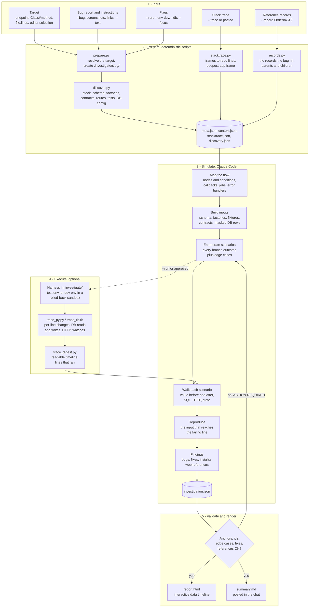
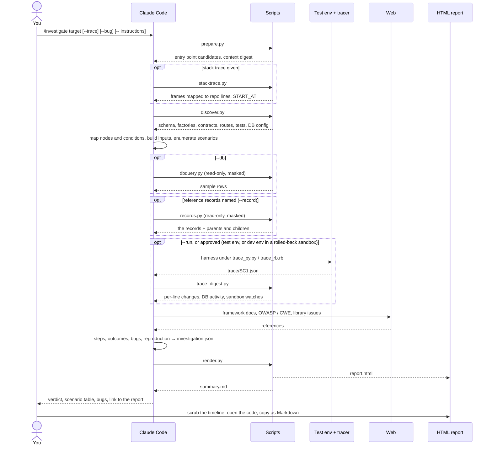
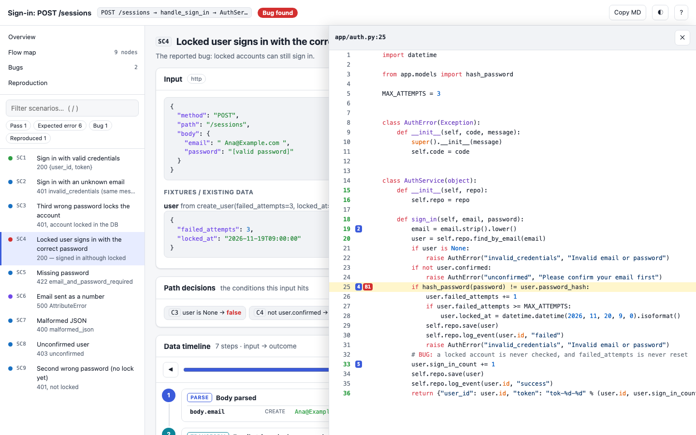

# claude-code-investigate: trace, simulate and debug data flow with Claude Code

[](https://github.com/rewin0087/claude-code-investigate#install)
[](https://github.com/rewin0087/claude-code-investigate/releases)
[](LICENSE)
[](https://rewin0087.github.io/claude-code-investigate/)

**`/investigate` is a debugging and data-flow simulation skill and plugin for [Claude Code](https://claude.com/claude-code).** Point it at an **endpoint**, a **method or class**, the **code you've highlighted**, a **bug report** or a **stack trace**, in **any tech stack**. It maps the flow from the raw input (an API or form request, or a method call) through **validation, branches, business logic, database CRUD, external API calls and state changes** to the **outcome**, and records the **file, line and method where each value changes**. It builds **realistic inputs** from your DB schema, factories and fixtures (or masked samples from your local DB), replays bugs on the **existing records they affected** (`Order#4512`), simulates **every path and edge case**, and can **run** them with a line-by-line runtime tracer. Runs go in your test environment, or in your **local development environment inside a rolled-back sandbox** that follows every DB read and write. It **reproduces errors** and **pin-points bugs** with fixes. It opens an **interactive HTML report**.

It runs on your existing Claude Code session, in the terminal, VS Code or JetBrains. You don't need an API key, a server or extra packages.


## Features

- **Input to outcome**: request parsing, strong params / DTOs, validations, callbacks, policies, services, ORM queries, transactions, external API clients, jobs, events and the response. Every step has a file, line and method.
- **Every path as a named scenario**, such as "Sign in with valid credentials", "…with an invalid password", "…when the account is locked" or "…with malformed JSON". Each has its input, the branch it takes at every condition, and the outcome. Its status is pass, expected error, bug, risk or reproduced.
- **Edge cases**: missing or wrong-typed fields, blank vs nil, boundaries, unicode and whitespace, duplicates, other tenants' records, permissions, concurrency, retries, and failing or timing-out external APIs.
- **Data timeline**: each value **before → after** at every step, with the SQL issued and the HTTP calls made. A state panel shows all the data at any step as you scrub through the scenario.
- **Realistic inputs**: built from the DB schema (types, NOT NULL, unique, foreign keys, enums), factories (FactoryBot, factory_boy, Fishery…), fixtures, seeds and API contracts (OpenAPI, GraphQL, DTOs, validators). With `--db`, it also uses masked read-only samples from your local DB.
- **Runtime tracers** for Python and Ruby/Rails, standard library only. They record calls with their arguments, every executed line and the locals, attributes or ActiveRecord fields it changed, SQL with bind values, outgoing HTTP, exceptions and return values. For other stacks, Claude writes a throwaway test that logs data snapshots.
- **Stack trace reproduction**: parses Python, Ruby/Rails, JS/TS, Java/Kotlin, Go, PHP and .NET traces, maps the frames to your files, and starts at the deepest app frame. It builds a scenario that reproduces the error and points at the step where the bad value is **created**, not just where it blows up.
- **Pin-pointed bugs**: the exact line, the value that makes it wrong, the scenarios that show it, a concrete fix with code, and references (framework docs, OWASP, CWE).
- **Run on your development data, safely**: with `--env dev`, scenarios run against your local
  development database inside a **rolled-back sandbox** (an ActiveRecord / Django / SQLAlchemy
  transaction). Every read and write is recorded, the watched records are shown before → after,
  emails and jobs are captured instead of sent, outbound network is blocked, and any COMMIT that
  escapes the rollback is reported.
- **Replay the records a bug affected**: name them (`--record Order#4512`, `"users where email = '…'"`,
  or just "order 4512" in your message). `records.py` fetches them read-only and masked, with
  their parents and children (via foreign keys or `*_id` columns), and the scenarios replay
  exactly that data.
- **Database activity per scenario**: the tables read, and every INSERT / UPDATE / DELETE with
  its line and values.
- **Your instructions**: bug reports, repro steps, expected behaviour, screenshots, ticket links, or free text after ` -- `.
- **Highlight and go**: select a method or class in VS Code or JetBrains and run `/investigate`.
- **Interactive report**: scenario list, data timeline with a state scrubber, flow and condition matrices, a code view that highlights the lines that actually ran, bugs, a reproduction view, keyboard navigation, dark mode, and Copy as Markdown.
- **Results in the chat**: the verdict, a table of every scenario, the bugs, the reproduction, and a link to the report.
- **Safe by default**: it never modifies your repo, executes only in the test environment, makes no real outbound calls, reads the DB read-only on localhost only, and masks secrets and personal data.

## Install

### As a Claude Code plugin (recommended)

In Claude Code (2.1.275 or later):

```text
/plugin install investigate --marketplace rewin0087/claude-code-investigate
```

Or in two steps, which works on any version with plugins:

```text
/plugin marketplace add rewin0087/claude-code-investigate
/plugin install investigate@rewin0087-investigate
```

From a shell: `claude plugin marketplace add rewin0087/claude-code-investigate && claude plugin install investigate@rewin0087-investigate`.

Claude Code namespaces plugin commands, so you run the plugin as **`/investigate:investigate`**. Update it with `claude plugin update investigate@rewin0087-investigate`.

### As a standalone skill (plain `/investigate`)

If you'd rather type `/investigate`, clone it as a skill. For every project:

```bash
git clone https://github.com/rewin0087/claude-code-investigate.git ~/.claude/skills/investigate
```

Or for one project only, clone it into `<repo>/.claude/skills/investigate`. Update with `git -C ~/.claude/skills/investigate pull`.

**Requirements:** Python 3.8+ (standard library only) and git. The Ruby tracer needs Ruby 2.6+.

## Usage

```text
/investigate "POST /users/sign_in"                   # an endpoint
/investigate AuthService#sign_in                     # a method or class
/investigate app/services/checkout.rb:40-90          # a line range
/investigate                                         # the code highlighted in your editor
/investigate --trace crash.log                       # reproduce a stack trace
/investigate --bug JIRA-123.md -- locked users can still log in
/investigate Orders::Checkout.call --run             # run the scenarios with the tracer (test env)
/investigate "POST /api/orders" --db --scenarios 12  # realistic inputs from masked local-DB rows
/investigate RefundService#call --env dev --record Order#4512 -- refunds on this order exceed the total
/investigate refund flow --focus concurrency -- two refunds for the same order at once
```

| Option | Meaning |
|---|---|
| target | `file`, `file:a-b`, `file#La-Lb`, `@file`, `Class#method`, `Mod::Class.method`, `"VERB /path"`, a job / event / mutation name, or plain words |
| `--selection` / `--file` | the editor selection / the open file. A selection is used automatically when there's no other target |
| `--trace <file\|text>` | a stack trace or error log to reproduce. A trace pasted in the chat works too |
| `--bug`, `--context` `<file\|url\|text>` | a bug report, repro steps, spec, screenshots or ticket links (repeatable) |
| `-- text` | free-text instructions: how to reproduce, what to simulate, which inputs to use, what "correct" means |
| `--run` / `--static` | always execute / never execute. By default it simulates, and asks before running a reproduction |
| `--env test\|dev` | where executed scenarios run: the test environment (default), or your local development DB inside a rolled-back sandbox (it always asks first) |
| `--record <ref>` | existing records to inspect and replay: `Model#id`, `table:id`, `"table where <condition>"` (repeatable) |
| `--db [url]` | allow read-only, masked sample queries against a local dev/test database |
| `--scenarios N` | aim for about N scenarios |
| `--focus <area>` | put more weight on an area (security, validation, payments, concurrency…) |
| `--no-open` | don't open the browser |

### Reproduce a bug or a stack trace

Give it the trace (`--trace`, or paste it), the bug report (`--bug`, a file, URL or text) and any instructions after ` -- `. It:

1. maps the trace frames to your files, innermost first, and starts at the deepest frame in your code
2. walks outward to find which input and which existing records reach the failing line
3. builds a `reproduction` scenario, and runs it in the test environment when you allow it (`--run`)
4. reports the root cause: the step where the bad value is **created**, not only where it raises

### Replay a bug on your development data

Name the records the bug hit, and let it run on the development environment:

```text
/investigate RefundService#call --env dev --record Order#4512 -- customer was refunded more than they paid
```

1. `records.py` reads `Order#4512` from your local dev DB, together with its parents and children
   (via foreign keys or `*_id` columns). It is read-only and masked.
2. Claude spots the values that drive the bug (here: `refunded_cents` 1500 of `total_cents` 2000).
3. After you approve, a harness runs the real code on that record inside a sandbox:

```ruby
InvestigateTrace.sandbox("SC3", watch: { order: -> { Order.find(4512) } }) do
  RefundService.new(4512, 1000).call
end
```

```text
Database activity:
  reads: orders ×1
  INSERT refunds at app/services/refund.rb:10  params=[4512, 1000]
  UPDATE orders at app/services/refund.rb:13  params=["refunded", 2500, 4512]

Sandbox SC3: rollback=active_record, rolled back=True, commits=0
  watch order.status: pending → refunded
  watch order.refunded_cents: 1500 → 2500
  email captured (not sent): Refund issued
  job captured (not enqueued): SyncLedgerJob
```

Your dev database is unchanged afterwards. If the code commits on its own (a separate connection,
or an explicit commit), the sandbox reports it, and the summary tells you which rows persisted.
In Python it's `with investigate_trace.sandbox("SC3", rollback="django", watch={...}):` (or pass a
SQLAlchemy session / DB-API connection).

### Investigate the code you've highlighted

The VS Code and JetBrains extensions share your selection with Claude Code. Highlight a method or class and run `/investigate`; a selection becomes the target automatically. `/investigate --file` targets the whole open file.

### Report keyboard shortcuts

| Key | Action |
|---|---|
| `j` / `k` | next / previous step in the data timeline |
| `]` / `[` | next / previous scenario |
| `c` | open the code of the current step |
| `o` / `f` / `b` / `r` | overview, flow map, bugs, reproduction |
| `/` | filter scenarios |
| `t` | toggle dark mode |
| `Esc` | close the code view |

## How it works

### Workflow: from input to outcome



| Stage | Who does it | Output |
|---|---|---|
| **1. Input** | You: a target, a trace, a bug report, instructions, flags | what to investigate |
| **2. Prepare** | `prepare.py`, `stacktrace.py`, `discover.py`: deterministic, no AI | `meta.json`, `context.json`, `stacktrace.json`, `discovery.json` |
| **3. Simulate** | Claude Code, guided by `SKILL.md` | `investigation.json` |
| **4. Execute** (optional) | your test runner + `trace_py.py` / `trace_rb.rb` | `trace/<scenario>.json` |
| **5. Validate and render** | `render.py`: checks every file:line, id and reference | `report.html`, `summary.md` |

The scripts handle the exact parts: which definition a symbol refers to, which repo line a stack frame is, what the schema and factories say, what the code actually did at runtime, and whether every file:line in the report exists. Claude does the reasoning: the flow, the scenarios, the root cause and the fix. `render.py` rejects any step that points at a line that doesn't exist. It warns when edge cases, fixes, references or the reproduction mapping are missing, and Claude fixes them before replying.

### Step by step



### The result

You get two outputs: a summary in the chat (below), and the interactive report in your browser.

```text
## Investigation: Sign-in: POST /sessions

**🐞 Bug found** — Locked accounts can still sign in, and a non-string email crashes the endpoint with a 500
Target: `POST /sessions → handle_sign_in → AuthService#sign_in` · Scenarios: 9 (2 executed with the tracer, 7 simulated)

| #   | Scenario                                       | Outcome                         | Status            |
| SC1 | Sign in with valid credentials                 | 200 {user_id, token}            | ✅ pass           |
| SC3 | Third wrong password locks the account         | 401, account locked in the DB   | 🛑 expected_error |
| SC4 | Locked user signs in with the correct password | 200 — signed in although locked | 🐞 bug            |
| SC6 | Email sent as a number                         | 500 AttributeError              | 🎯 reproduced     |

### Bugs
1. **[major] Locked accounts can sign in** `app/auth.py:25`
   Root cause: `locked_at` is written at app/auth.py:29 but never read.
   Fix: Reject locked users before checking the password, and reset `failed_attempts` on success.

### Reproduction
Error: `AttributeError: 'int' object has no attribute 'strip'` · Confirmed by running it. Fails at SC6 step 2.

Full report (data timeline per scenario, flow map, code): report.html
```

**Report layout**

```text
+--------------------------------------------------------------------------------+
| Sign-in: POST /sessions   [POST /sessions -> AuthService#sign_in]  [BUG FOUND] |
+-----------------------+--------------------------------------------------------+
| Overview              | SC4  Locked user signs in with the correct password    |
| Flow map      9 nodes | +- Input ----------------+ +- Outcome --------------+  |
| Bugs                2 | | POST /sessions {...}   | | 200, but 403 expected  |  |
| Reproduction          | +------------------------+ +------------------------+  |
| [Filter scenarios...] | Path decisions: C3 user is None -> F  C5 pw ok -> F    |
| (Pass) (Bug) (Repro)  | Data timeline  [<] ======o======== [>]  step 6 of 7    |
|                       | (1) PARSE body.email        | Data after step 6        |
| * SC1 Valid sign in   | (2) TRANSFORM email         |  email      ana@ex.com   |
| * SC2 Unknown email   |     " Ana@Ex.com " -> "ana" |  user.locked_at  ...     |
| * SC4 Locked user  <  | (4) AUTH  locked_at ignored |  user.sign_in_count 1    |
| * SC6 Email number    |     BUG B1                  |  db.users  UPDATE        |
+-----------------------+--------------------------------------------------------+
```

| Overview | Flow map |
|---|---|
|  |  |



### Runtime tracers

```bash
# Python: use the project's interpreter so its packages import
.venv/bin/python scripts/trace_py.py --root . --out .investigate/x/trace/SC1.json --entry sign_in \
    -- -m pytest .investigate/x/harness/sim_sc1.py -q

# Ruby / Rails: wrap exactly the scenario in a harness...
require "/path/to/scripts/trace_rb.rb"
InvestigateTrace.record("SC1") { post "/users/sign_in", params: { user: { email:, password: } } }

# ...or trace an existing spec as it is
TRACE_AUTOSTART=1 TRACE_OUT=$PWD/.investigate/x/trace/SC1.json TRACE_ROOT=$PWD \
  RUBYOPT="-r/path/to/scripts/trace_rb.rb" RAILS_ENV=test bundle exec rspec spec/requests/sessions_spec.rb:12

python3 scripts/trace_digest.py .investigate/x/trace/SC1.json
```

```text
#15  → AuthService.sign_in(email=' Ana@Example.com ', password='[redacted]')  [app/auth.py:18]
#16      app/auth.py:19  email: ' Ana@Example.com ' → 'ana@example.com'
#20      app/models.py:25  SQL SELECT … FROM users WHERE email = 'ana@example.com'
#33      app/auth.py:20  user.failed_attempts: ∅ → 3; user.locked_at: ∅ → '2026-11-19T09:00:00'
#40      app/auth.py:33  user.sign_in_count: 0 → 1
#44      app/models.py:30  SQL UPDATE users SET failed_attempts = 3, … sign_in_count = 1 WHERE id = 1
#58  ← handle_sign_in returned (200, {'user_id': 1, 'token': '[redacted]'})  [app/api.py:24]
Executed lines: app/auth.py: 18-21,23,25,33-36     ← 26-31 (the wrong-password branch) did not run
```

### Safety

- It writes only to `<repo>/.investigate/`, which is added to `.git/info/exclude`. Your files are never changed.
- It executes only through your test runner in the test environment, where tests run in rolled-back transactions. It asks first unless you passed `--run`.
- On the development environment (`--env dev`), it always asks first. It runs only against a local
  database (localhost, a socket or a sqlite file), and only inside a sandbox transaction that is
  rolled back. Emails and jobs are captured, and COMMITs that escape the rollback are reported.
- Outbound network connections are blocked while tracing, except loopback (`--allow-host` /
  `TRACE_ALLOW_HOSTS` to allow one).
- External APIs are stubbed with your tools (WebMock/VCR, responses, nock/MSW…). If they can't be stubbed, that part is simulated.
- `dbquery.py` and `records.py` run one read statement at a time, against localhost or a sqlite file, in a read-only session, with a LIMIT. Secret columns are redacted and personal data is masked.
- The tracers redact password, secret, token and key-like values. The report uses synthetic identities.

### Files

```
SKILL.md                         instructions Claude follows (targets, safety, scenarios, reproduction, output)
references/investigation-schema.md   the investigation.json format Claude writes
templates/report.html            the self-contained interactive report

scripts/                         thin command-line entry points
  prepare.py                     target + context -> .investigate/<slug>/ (meta.json, context.json)
  stacktrace.py                  stack trace -> frames mapped to repo lines (stacktrace.json)
  discover.py                    schema, factories, contracts, routes, tests, DB config (discovery.json)
  dbquery.py                     read-only, masked sample rows from a local DB
  records.py                     the records a bug affected + their parents/children (read-only, masked)
  trace_py.py                    Python runtime tracer (standalone: run with the project's interpreter)
  trace_rb.rb                    Ruby / Rails runtime tracer (standalone: require it in a harness)
  trace_digest.py                trace log -> readable per-line timeline
  render.py                      investigation.json -> report.html + summary.md

scripts/tracekit/                the logic, one concern per module (raises InvestigateError instead of exiting)
  errors.py  jsonio.py           InvestigateError; load_json / write_json
  gitcmd.py                      Git: running git for one repository
  sourcefile.py                  SourceFile, SourceCache: lines, snippets, enclosing definitions
  workspace.py                   Workspace: the repo + its output folder and meta.json
  preparer.py                    Preparer: resolve targets, create the folder, collect context
  target.py                      TargetResolver: file:line / Class#method / route / text -> candidates
  context.py                     ContextCollector, SourceDocument: bug reports, specs, images, links
  stacktrace.py                  StackTraceParser, FrameMapper, StackTraceDigest
  discover.py                    AppDiscovery, FileCategorizer, TestRunnerFinder
  stacks.py                      StackDetector: languages and frameworks from manifests
  dbconfig.py                    DbConfigReader: DB settings, credentials redacted
  dbsafe.py                      SqlGuard (single read statement + LIMIT), DatabaseUrl (local only)
  dbrunner.py                    QueryRunner: SqliteRunner, PostgresRunner, MysqlRunner (read-only sessions)
  masking.py                     RowMasker: secrets redacted, personal data masked
  records.py                     RecordRef, SchemaIntrospector, RecordGraph: reference data via FKs / *_id
  tracelog.py                    TraceLog (load, compact), TraceDigest (readable timeline)
  renderer.py                    Renderer, RenderResult: validate + build the report and summary
  vocabulary.py                  the enums of investigation.json
  validator.py                   InvestigationValidator
  snippets.py                    SnippetCollector: source code embedded in the report
  summary.py                     SummaryWriter: the markdown summary posted in the chat
  report.py                      ReportBuilder: template + embedded JSON
```

The tracers are classes too: `AppFiles`, `ValueFormatter`, `Snapshotter`, `EventLog`, `LibraryProbe`, `NetworkGuard`, `Sandbox`, `TraceApi`, `Recorder` and `TraceRunner` in Python, and the matching classes in Ruby (including `NetworkGuard` and `Sandbox`). Each stays a single file, so it runs under your project's interpreter without installing anything.

Syntax highlighting loads highlight.js from cdnjs. Without internet the report still works, just without colours.

## Related

- [claude-code-review](https://github.com/rewin0087/claude-code-review): `/branch-review`, AI code review of your branch's changes with an interactive HTML diff report.

## Contributing

Issues and pull requests are welcome. If `/investigate` helped you find a bug, a ⭐ on GitHub helps other developers find it.

See [CHANGELOG.md](CHANGELOG.md) for release notes.

## License

MIT
