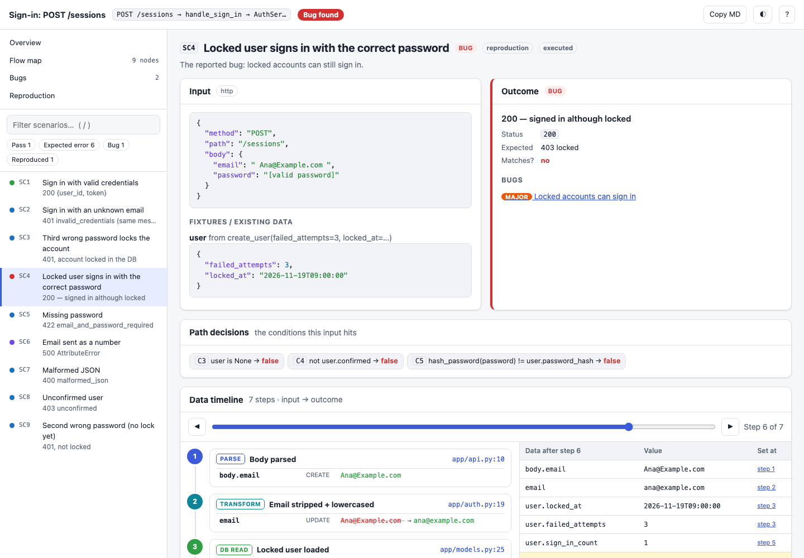
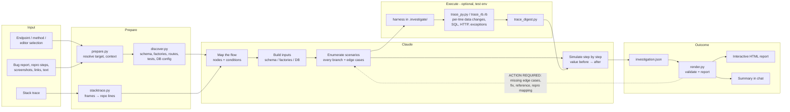
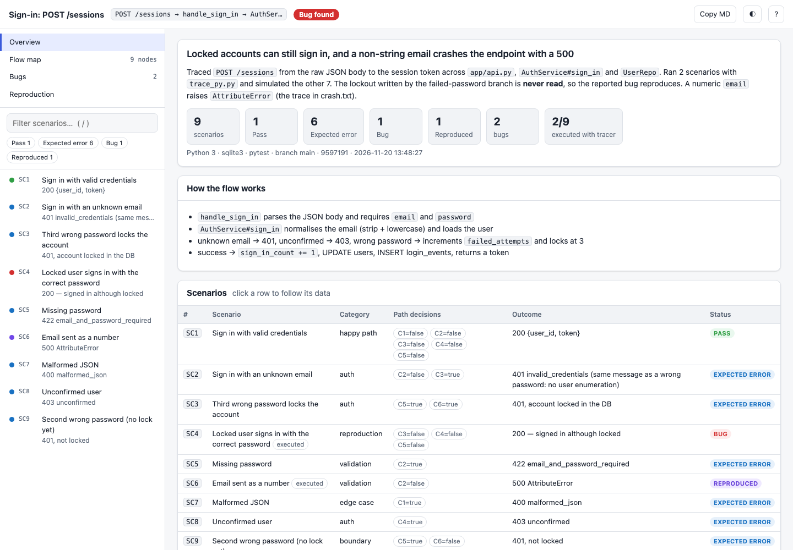
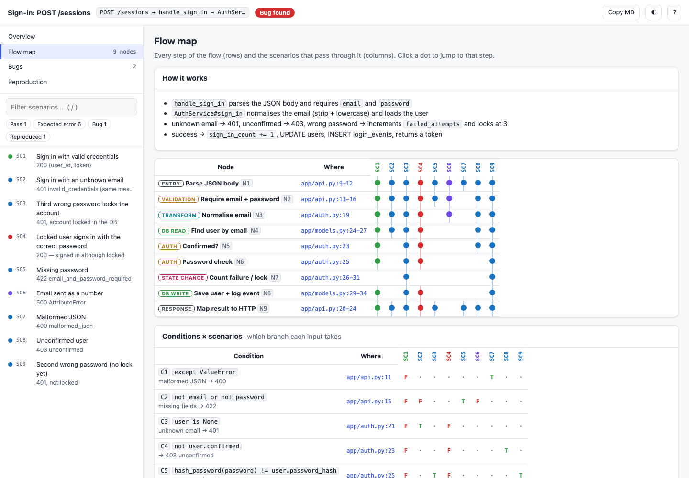

# claude-code-investigate: trace, simulate and debug data flow with Claude Code

[](LICENSE)
[](https://docs.claude.com/en/docs/claude-code/skills)


`/investigate` is a [Claude Code](https://claude.com/claude-code) skill. It follows your data
through the app. Point it at an endpoint, a method, the code you highlighted, a bug report or a
stack trace. It maps the flow from the **raw input** (an API or form request, or a method call)
through validation, branches, business logic, **database CRUD**, **external API calls** and
**state changes** to the **outcome**. On the way it records the **file, line and method where
each value changes**.

It builds realistic inputs from your **DB schema, factories, fixtures** (or, if you allow it,
your local DB). It covers every path: the happy path, each failure branch and the edge cases. It
can **run** the scenarios in your test environment with a line-by-line runtime tracer,
**reproduces** reported errors, **pin-points bugs** with fixes, and opens an interactive HTML
report.



## What you get

- **Scenarios for every path**: "Sign in with valid credentials", "…with an invalid password",
  "…when locked", "…with malformed JSON", and so on. Each has its input, path decisions and outcome,
  and a status: pass, expected error, bug, risk or reproduced.
- **A data timeline per scenario.** Each step shows *where* (file:line, method), *what* (parse,
  validation, transform, DB read/write, external call, state change, response) and **every value
  before → after**, with the SQL and HTTP calls. A state panel shows all the data at any step as
  you scrub through.
- **A flow map.** One matrix shows which scenarios pass through which nodes. A second shows which
  way each condition went (`T` / `F`).
- **A runtime tracer** (Python and Ruby, standard library only). It records calls and arguments,
  every executed line and the locals, attributes or ActiveRecord fields it changed, SQL with
  binds, outgoing HTTP, exceptions and return values. Executed lines are highlighted in the
  code view.
- **Stack trace reproduction.** It parses traces in Python, Ruby/Rails, JS/TS, Java/Kotlin, Go, PHP
  and .NET, maps the frames to your files, starts at the deepest app frame, and builds a scenario
  that reproduces the failure. That scenario points at the step where the bad value is
  *created*, not only where it blows up.
- **Bugs with root cause and fix.** Each gives the exact line, the value that makes it wrong, a
  code fix, and references (docs, OWASP, CWE).
- **Realistic test data** from the schema (types, NOT NULL, unique, FKs, enums), factories
  (FactoryBot, factory_boy, Fishery…), fixtures, seeds, OpenAPI/GraphQL/DTO contracts, or masked
  read-only samples from a local DB.
- **Your own instructions**: bug reports, repro steps, expected behaviour, screenshots, ticket
  links, or free text after `--`.
- **Safe by default.** It never modifies your repo, executes only in the test environment, makes
  no real outbound calls, reads the DB read-only on localhost only, and masks secrets and personal data.

## Install

**As a plugin (recommended)**

```bash
claude plugin marketplace add rewin0087/claude-code-investigate
claude plugin install investigate@rewin0087-investigate
```

Then run `/investigate:investigate …`. Update with `claude plugin update investigate@rewin0087-investigate`.

**As a personal skill** (shows up as `/investigate` in every project)

```bash
git clone https://github.com/rewin0087/claude-code-investigate ~/.claude/skills/investigate
```

Requirements: Python 3.8+ (standard library only), git. Ruby 2.6+ only for the Ruby tracer.

## Usage

```text
/investigate "POST /users/sign_in"                         # an endpoint
/investigate AuthService#sign_in                           # a method or class
/investigate app/services/checkout.rb:40-90                # a line range
/investigate                                               # the code highlighted in VS Code / JetBrains
/investigate --trace crash.log                             # reproduce a stack trace
/investigate --bug JIRA-123.md -- locked users can still log in
/investigate Orders::Checkout.call --run                   # execute scenarios with the tracer (test env)
/investigate "POST /api/orders" --db --scenarios 12        # use masked local-DB samples for inputs
/investigate refund flow --focus concurrency -- two refunds for the same order at once
```

| Option | Meaning |
|---|---|
| target | `file[:a-b]`, `file#La-Lb`, `Class#method`, `"VERB /path"`, a job, event or mutation name, or words |
| `--selection` / `--file` | use the editor selection / the open file (a selection is used automatically) |
| `--trace <file\|text>` | stack trace or error log to reproduce (a trace pasted in the chat works too) |
| `--bug`, `--context` `<file\|url\|text>` | bug report, repro steps, spec, screenshots, ticket links |
| `-- text` | free-text instructions: how to reproduce, what to simulate, what "correct" means |
| `--run` / `--static` | always execute in the test env / never execute (default: static, and it asks before running a reproduction) |
| `--db [url]` | allow read-only, masked sample queries against a local dev/test DB |
| `--scenarios N`, `--focus <area>` | how many scenarios, and what to emphasise |
| `--no-open` | don't open the browser |

In the report: `j`/`k` move between steps, `[`/`]` between scenarios, `c` opens the code, `o`/`f`/`b`/`r`
switch views, `/` filters, and `t` changes the theme.

## How it works



| Stage | What happens |
|---|---|
| Prepare | Finds the definition / route for the target, creates `.investigate/<slug>/` (git-ignored), and collects your bug report, images and links |
| Stack trace | Parses the frames, maps them to repo files, and prints snippets from the deepest app frame outward |
| Discover | Stack and frameworks, schema and migrations, models, factories, fixtures, contracts, routes, tests, test runner, tracer support, DB config (redacted) |
| Map | Claude reads the code as the runtime would, including middleware, callbacks, validations, policies, jobs and error handlers |
| Scenarios | One per branch outcome, plus edge cases: validation, auth, not-found, boundaries, unicode, duplicates, concurrency, external failures |
| Execute | Optional. A throwaway harness runs in the test env under the tracer, and the scenario's steps come from the recorded trace |
| Render | Validates every anchor and id, then warns about missing edge cases, fixes, references or reproduction mapping, and builds the report |

### Runtime tracers

```bash
# Python: use the project's interpreter so its packages import
.venv/bin/python scripts/trace_py.py --root . --out .investigate/x/trace/SC1.json --entry sign_in \
    -- -m pytest .investigate/x/harness/sim_sc1.py -q

# Ruby / Rails: wrap exactly the scenario in a harness
require "/path/to/scripts/trace_rb.rb"
InvestigateTrace.record("SC1") { post "/users/sign_in", params: { user: { email:, password: } } }

# …or trace an existing spec as-is
TRACE_AUTOSTART=1 TRACE_OUT=$PWD/.investigate/x/trace/SC1.json TRACE_ROOT=$PWD \
  RUBYOPT="-r/path/to/scripts/trace_rb.rb" RAILS_ENV=test bundle exec rspec spec/requests/sessions_spec.rb:12

python3 scripts/trace_digest.py .investigate/x/trace/SC1.json
```

Example digest:

```text
#15  → AuthService.sign_in(email=' Ana@Example.com ', password='[redacted]')  [app/auth.py:18]
#16      app/auth.py:19  email: ' Ana@Example.com ' → 'ana@example.com'
#20      app/models.py:25  SQL SELECT … FROM users WHERE email = 'ana@example.com'
#33      app/auth.py:20  user.failed_attempts: ∅ → 3; user.locked_at: ∅ → '2026-11-19T09:00:00'
#40      app/auth.py:33  user.sign_in_count: 0 → 1
#44      app/models.py:30  SQL UPDATE users SET failed_attempts = 3, locked_at = '…', sign_in_count = 1 WHERE id = 1
#58  ← handle_sign_in returned (200, {'user_id': 1, 'token': '[redacted]'})  [app/api.py:24]
Executed lines: app/auth.py: 18-21,23,25,33-36     ← lines 26-31 (wrong-password branch) did not run
```

For other stacks (JS/TS, Go, JVM, PHP, .NET), Claude writes a harness test that logs data
snapshots between stages and runs it with your test runner. Otherwise it simulates statically.

### Screenshots

| Overview | Flow map |
|---|---|
|  |  |


## Safety

- Writes only to `<repo>/.investigate/` (added to `.git/info/exclude`). Repo files are never changed.
- Executes only through your test runner in the test environment, where each test runs in a
  rolled-back transaction. It asks before running anything unless you passed `--run`.
- External APIs are stubbed with your tools (WebMock/VCR, responses, nock/MSW…). If they can't
  be stubbed, that part is simulated.
- `dbquery.py` allows a single read statement, on localhost or sqlite only, in a read-only
  session, with a LIMIT, secret columns redacted and personal data masked.
- The tracers redact password, secret, token and key-like values. Reports use synthetic
  identities.

## Files

```text
SKILL.md                        the workflow Claude follows
references/investigation-schema.md
scripts/
  prepare.py   discover.py   stacktrace.py   dbquery.py   render.py      CLIs (thin wrappers)
  trace_py.py  trace_rb.rb   trace_digest.py                             runtime tracers
  tracekit/    target, context, stacktrace, discover, dbsafe, tracedigest, model, snippets, summary, report
templates/report.html           the interactive report (self-contained, light/dark)
.claude-plugin/                 plugin + marketplace manifests
```

## Related

- [claude-code-review](https://github.com/rewin0087/claude-code-review): `/code-review`, an AI code
  review of your branch's changes with an interactive HTML report.

## License

MIT © rewin0087
